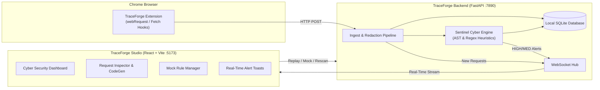

<div align="center">

# 🛡️ TraceForge
### Local-First Network Interception, Mock Replay & Heuristic Cyber Security Studio

[](https://fastapi.tiangolo.com)
[](https://react.dev)
[](https://vitejs.dev)
[](https://developer.mozilla.org/en-US/docs/Web/API/WebSockets_API)
[](LICENSE)

TraceForge is a developer & cybersecurity engineering toolkit that captures browser HTTP traffic in real time, redacts sensitive secrets at ingestion, detects OWASP & security vulnerabilities on the fly via the **Sentinel Engine**, and provides multi-language code generation and mock replay capabilities.

[Features](#-key-features) • [Architecture](#-architecture) • [Getting Started](#-getting-started) • [Sentinel Engine](#-sentinel-cybersecurity-engine) • [API Reference](#-api-endpoints)

---

</div>

## ✨ Key Features

- ⚡ **Zero-Config Real-Time Capture**: Chrome Extension intercepts HTTP/HTTPS network traffic (`fetch` & `XMLHttpRequest`) directly from your browser and streams it into TraceForge Studio over WebSockets.
- 🛡️ **Sentinel Cybersecurity Audit Engine**: Continuous heuristic auditing of every incoming and outgoing network call:
  - **Injection Vulnerabilities**: SQL Injection (SQLi), Cross-Site Scripting (XSS), Path Traversal / Local File Inclusion (LFI).
  - **Authentication & Secret Leaks**: Exposed JWTs/API tokens in URLs, leaked private keys, unmasked passwords in response bodies.
  - **Network & CORS Misconfigurations**: Permissive CORS (`*` with credentials), insecure HTTP transport, missing standard security headers (`CSP`, `HSTS`, `X-Frame-Options`, `X-Content-Type-Options`).
  - **Performance & DoS Anomalies**: N+1 request loop detection, slow endpoint thresholds, oversized payloads.
- 🔔 **Real-Time WebSocket Alert Toasts**: Floating animated notifications with glowing severity banners whenever a `HIGH` or `MEDIUM` security vulnerability is detected.
- 🎭 **Live Mock Rules Engine**: Intercept API requests directly in the browser and inject custom status codes, response payloads, headers, or simulated network latency without modifying backend code.
- 🔄 **Instant Request Replay**: Re-trigger any captured endpoint with custom parameters, headers, or body payloads directly from the Studio interface.
- 💻 **Multi-Language Code Generation**: One-click code generation for **cURL**, **Python (HTTPX)**, **Python (Requests)**, **JavaScript (Fetch)**, and **JavaScript (Axios)**.
- 🔒 **Privacy-Preserving Redaction**: Automatically scrubs authorization tokens, credit cards, and sensitive customer secrets before saving to disk.

---

## 🏛️ Architecture



---

## 🚀 Getting Started

### Prerequisites
- **Python 3.11+**
- **Node.js 18+** & `npm`

---

### 1. Start Backend

```bash
cd backend

# Create & activate virtual environment (optional)
python -m venv .venv
# Windows: .venv\Scripts\activate
# Linux/macOS: source .venv/bin/activate

pip install -r requirements.txt
python run.py
```
*The backend starts at `http://127.0.0.1:7890`.*

---

### 2. Start Studio Dashboard

```bash
cd studio
npm install
npm run dev
```
*TraceForge Studio will be running at `http://localhost:5173`.*

---

### 3. Load Chrome Extension

1. Open Google Chrome and navigate to `chrome://extensions/`.
2. Toggle on **Developer mode** in the top-right corner.
3. Click **Load unpacked** and select the `extension/` folder from this repository.
4. Open any web application to start capturing and auditing network traffic automatically!

---

## 🛡️ Sentinel Cybersecurity Engine

Every captured request is assigned an overall **Security Posture Grade (`A`, `B`, `C`, `D`, `F`)** based on threat evaluations:

| Grade | Risk Level | Description |
| :---: | :--- | :--- |
| **A** | **Secure** | No security deficiencies detected; strict headers and sanitized inputs. |
| **B** | **Low Notice** | Minor header hardening recommendations (e.g. missing `X-Content-Type-Options`). |
| **C** | **Moderate Warning** | Weak CORS policies or potential info disclosure patterns. |
| **D** | **High Risk** | Clear-text credentials in URLs, unmasked tokens, or missing authentication. |
| **F** | **Critical Vulnerability** | Active SQL Injection, XSS, Path Traversal, or leaked private keys. |

---

## 📡 API Endpoints

| Method | Route | Description |
| :--- | :--- | :--- |
| `POST` | `/api/ingest` | Ingest and redact captured HTTP traffic |
| `GET` | `/api/requests` | List and filter captured requests |
| `GET` | `/api/requests/{id}` | Retrieve request details, headers, and body |
| `DELETE` | `/api/requests` | Clear captured request history |
| `GET` | `/api/requests/{id}/audit` | Fetch Sentinel findings, risk score, and grade for a request |
| `POST` | `/api/requests/{id}/audit/rerun` | Re-run Sentinel heuristics on a request |
| `GET` | `/api/audit/summary` | Global threat intelligence metrics & posture grade |
| `GET` | `/api/audit/findings` | Filterable real-time security findings feed |
| `POST` | `/api/replay` | Replay an HTTP request with custom parameters |
| `POST` | `/api/requests/{id}/codegen` | Generate cURL, Python, and JS code snippets |
| `GET` | `/api/mock-rules` | List all dynamic mock rules |
| `POST` | `/api/mock-rules` | Create a new mock interception rule |

---

## 🧪 Running Tests

```bash
cd backend
pytest
```

---

## 📄 License

This project is licensed under the **MIT License** - see the [LICENSE](LICENSE) file for details.
